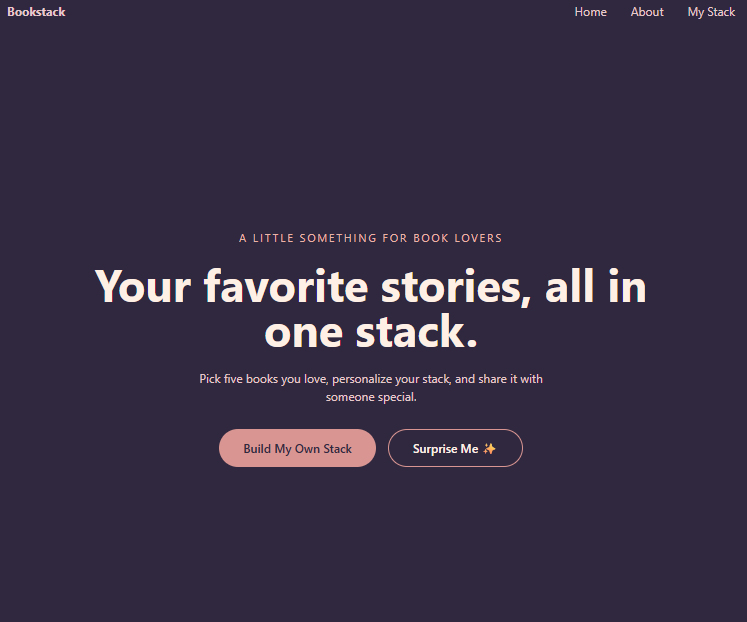
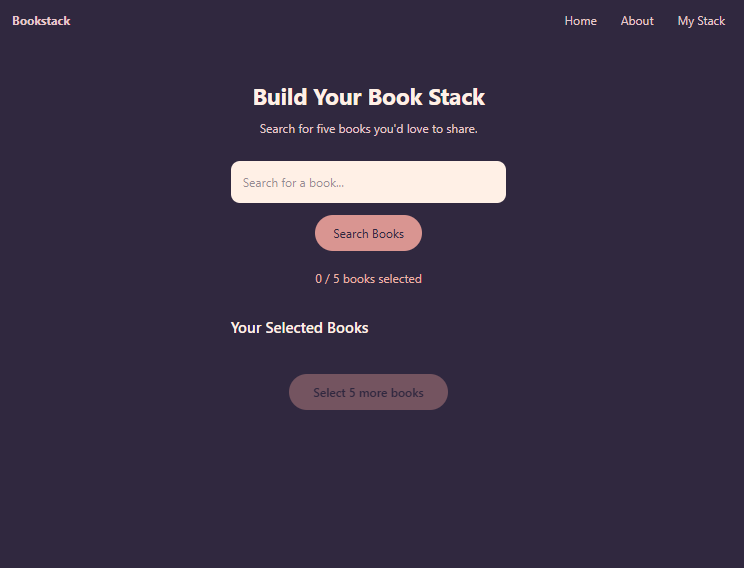
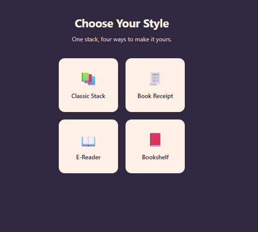
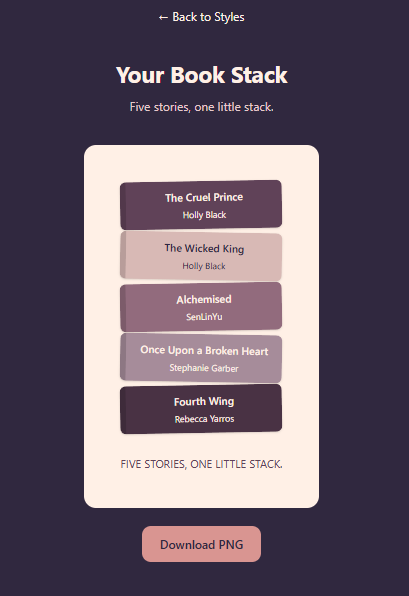
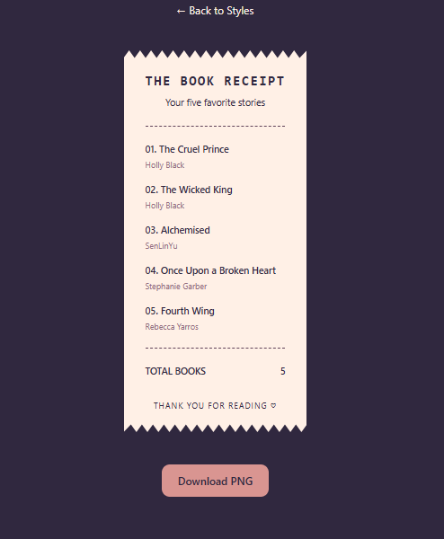
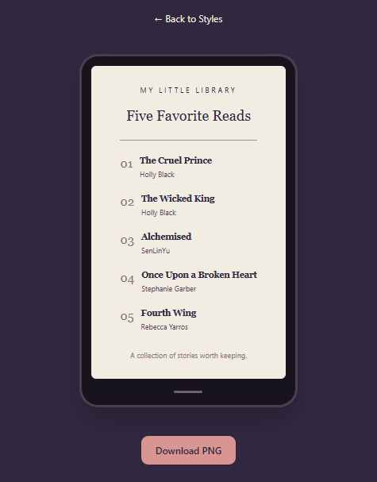
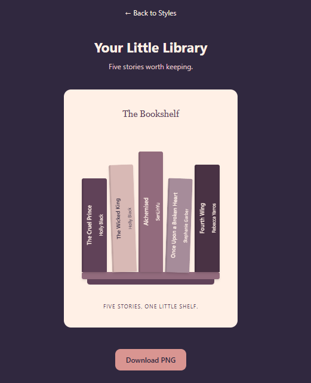

# 📚 BookStack

**A little project for people who love books.**

BookStack lets you pick five of your favorite books and turn them into a personalized design that you can download and share.

Whether it's your all-time favorites, recent reads, or books you keep recommending to everyone, you can put them all in one stack.

## Features

- Search for books using the Open Library API
- Select up to five books
- Choose from four different designs
- Download your finished stack as a PNG

## The Designs

- **Classic Stack** — A simple stack of books
- **Book Receipt** — Your reading list in receipt form
- **E-Reader** — A digital reading list
- **Bookshelf** — Your books lined up on a shelf

## Preview



## Designs







## Built With

- React
- Vite
- Tailwind CSS
- Open Library API
- html-to-image

## Getting Started

Clone the repository:

```bash
git clone https://github.com/YOUR-USERNAME/bookstack.git
cd bookstack
```

Install dependencies and run the project:

```bash
npm install
npm run dev
```

## Still Working On

- Random book recommendations
- Saving selected books after refreshing
- Improving the mobile layout
- More design options

## Why I Made This

I wanted to make something fun while practicing React and working with APIs. I liked the idea of turning a simple reading list into something visual that people could share.

This project helped me get more comfortable with React state, reusable components, API requests, and generating downloadable images.

---

*For the books you loved, the ones you couldn't finish, and the ones still sitting on your TBR.*